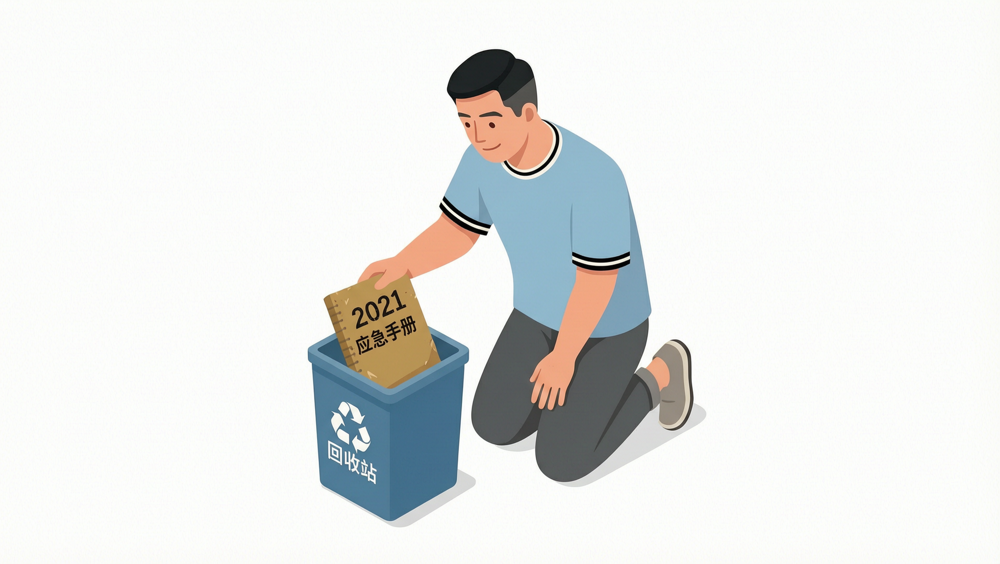

# 本周复盘：三个让我删掉又写回来的文件夹

> 栏目：心路历程
> 主题：复盘随笔
> 计划发稿：2026-10-24 20:30

这周没做什么惊天动地的事。周六下午，手机又跳出来那个熟悉的提示——"存储空间不足"。

于是我坐下来，干了一件每年至少要做三次的事：清理文件夹。相册、工作笔记、收藏夹，挨个打开，能删的删，能归档的归档。一小时后，存储倒是腾出了两个 G，我却发现一件有点意思的事——**有三个东西，我删掉了，没过多久又亲手写了回来。**

这三个"删掉又写回来"的动作，其实都是关于"取舍"的答案。

## 文件夹一：相册里那张"拍糊了"的全家福

删的第一样东西，是一张照片。

翻相册的时候，我划到一张去年 dorian 生日拍的全家福。照片有点糊，对焦没对准，背景还伸进来半条路人的胳膊。按"清理标准"，这张连收藏的价值都谈不上——于是我点了删除。

删完之后，心里却不太得劲。那天的记忆是清楚的：dorian 吹蜡烛，吹了两下都没吹灭，急得眼圈都红了；我在旁边憋着笑，妻子手忙脚乱地找第二个打火机。**那张"糊掉"的照片里藏着的不是画面，是那天的慌乱、笑声，和我没来得及说出口的"你看，你都四岁了"。**

我打开"最近删除"，把它恢复了。

> 存储可以清理，记忆不可以。有些东西看着"没用"，其实是记忆的锚点——你把它删了，那个下午就真的只会越来越淡。

我突然理解了老一辈的人为什么不爱删照片。不是舍不得那点空间，是舍不得那个"证据"。

## 文件夹二：工作笔记里那份"被新技术淘汰"的清单

第二样，是一份工作笔记。

做安全这行，我的笔记堆得特别快。这周整理的时候，翻到一份五年前的笔记，标题是"某老系统应急响应手册"。扫了一眼，里面的框架早就不维护了，命令也过时了，我直接扔进了回收站。

结果周三晚上，团队复盘一个老系统的漏洞，我隐约记得"这个东西五年前我们处理过类似的情况"。翻遍新笔记找不到，最后是从回收站里把那份老手册捞了回来。

打开一看，过时的命令确实用不上了，但那份手册里记的思路——**怎么定位、怎么隔离、怎么在半夜三点保持清醒地做判断——一点都没过时。** 工具会迭代，但处理问题的底层逻辑，时间越久越值钱。

> 我们总喜欢用"新"去否定"旧"。可工具会过期，思路会复利。

我把这份笔记又放回了它原来的文件夹，顺手在标题后面加了一行小字："2021，回看仍有价值。"

## 文件夹三：收藏夹里那个"收藏了三年没打开"的链接

第三样，是一个收藏夹里的链接。

我的收藏夹里存着上千个链接，绝大多数是"先存下来，以后再看"——然后就没有然后了。这周我下了决心，把收藏夹里超过一年没打开的通通删掉。

删到一半，我停在一个链接上。那是一个关于"如何有质量地陪伴孩子"的课程介绍，三年前就收藏了，一直没点开。

我盯着它想了很久。三年了，dorian 从一岁长到了四岁，这个链接我一次都没打开过。**我没打开它，不是不需要，而是"收藏"这个动作本身，让我产生了一种"我已经拥有了"的错觉。**

收藏不等于拥有。一个读过的观点才算拥有，一个用起来的方法才算学会。那些躺在收藏夹里吃灰的东西，不是资产，是我欠自己的债。

最后我没删它，但做了一件事——把这条链接从"以后再看"移到了一个叫"这周就用"的新文件夹里。

> 取舍的难点，从来不在于"删不删"，而在于你敢不敢说：我要么现在就用，要么就承认我不需要。

---

三个文件夹，三次"删掉又写回来"。

相册那张照片，我写回来，是因为它承载记忆；工作笔记那份清单，我写回来，是因为思路不过期；收藏夹那个链接，我写回来，是因为我要逼自己"要么用、要么删"。

**取舍从来不是一味地删，也不是一味地留。它是删掉的勇气，加上写回来的诚实。** 敢删，说明你分得清什么不重要；敢写回来，说明你认得出什么值得。

这大概就是成年人面对信息、记忆和时间时，最体面的姿势了。

---

*你的这周，有没有什么"删了又写回来"的东西？欢迎在评论区聊聊。*